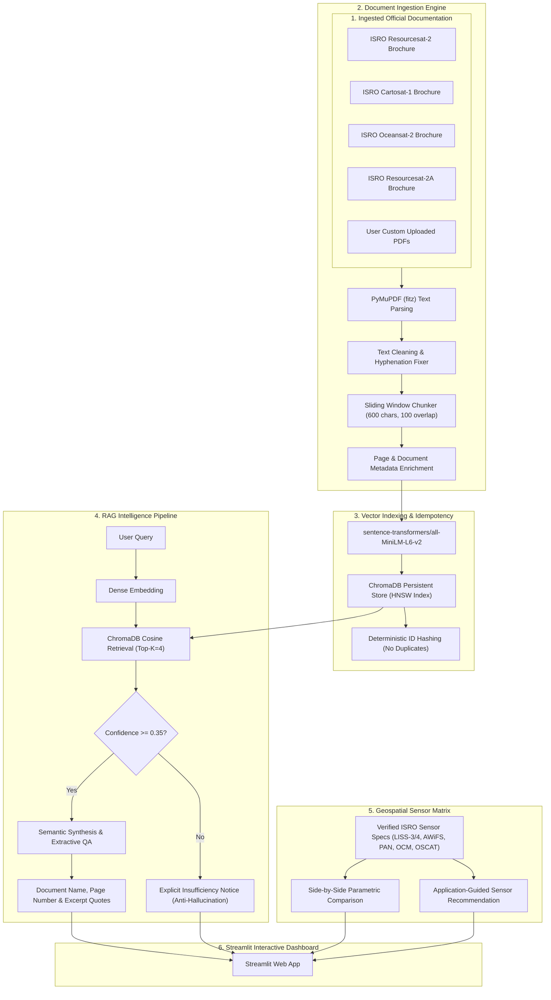

# 🛰️ BhuvanGeo-RAG: Multimodal Geospatial Document & Mission Intelligence Assistant

[](https://github.com/aditi789soni/BhuvanGeo-RAG)
[](https://www.isro.gov.in)
[](https://www.python.org/)
[](https://www.trychroma.com/)
[](https://huggingface.co/sentence-transformers/all-MiniLM-L6-v2)
[](https://streamlit.io/)
[](#)

**BhuvanGeo-RAG** is an autonomous geospatial document intelligence system and retrieval-augmented mission assistant engineered for the **National Remote Sensing Centre (NRSC) / Indian Space Research Organisation (ISRO)**.

The system ingests, structures, and indexes official technical documentation across flagship Indian Earth Observation missions—including **Resourcesat-1/2/2A**, **Cartosat-1/2/3**, **Oceansat-2/EOS-06**, and the **Bhuvan Geoportal**. It delivers grounded, zero-hallucination semantic question-answering, side-by-side payload comparisons, and operational sensor recommendations with strict citation attribution.

---

## 🚀 Key Features

- **📑 High-Fidelity PDF Processing:** Powered by `PyMuPDF` (`fitz`), preserving 1-based page numbers, document hierarchy, text cleaning (hyphenation resolution across linebreaks), and dynamic sliding-window chunking.
- **⚡ Local Vector Storage & Fast Retrieval:** Persistent `ChromaDB` integration with `sentence-transformers/all-MiniLM-L6-v2` dense embeddings running 100% locally on CPU without external API dependencies.
- **🛡️ Strict Anti-Hallucination Guardrails:** Zero fabricated specifications. If similarity falls below verified evidence thresholds, the engine explicitly reports insufficiency rather than speculating.
- **📌 Mandatory Source Attribution:** Every answer is backed by the exact document name, page number, similarity score, and literal supporting text quote.
- **🔍 Geospatial Sensor Intelligence Catalog:** Parametric comparison matrix for **LISS-IV, LISS-III, AWiFS, Cartosat PAN, OCM-2/3, and OSCAT**, with application-guided operational recommendations (e.g., cadastral mapping vs. national crop monitoring).
- **🌐 Modern Streamlit Dashboard:** Multi-tab interactive UI featuring real-time chat, source inspector cards, dynamic PDF uploader, sensor comparison matrix, and system diagnostic telemetry.
- **🧪 Automated Benchmark & Evaluation Suite:** Unit tests and an end-to-end benchmark measuring retrieval and answer latencies across 10+ satellite questions and out-of-domain probes.

---

## 🏛️ System Architecture



---

## 📂 Project Structure

```text
BhuvanGeo-RAG/
├── app/
│   └── app.py                      # Streamlit interactive dashboard
├── data/
│   ├── documents/                  # Official ISRO & NRSC PDF documents
│   │   ├── documents_manifest.json # Registry of URLs, titles, and filenames
│   │   ├── ISRO_Resourcesat-2_Brochure.pdf
│   │   ├── ISRO_Cartosat-1_Brochure.pdf
│   │   └── ISRO_Oceansat-2_Brochure.pdf
│   └── processed/                  # Extracted chunk caches & ingestion summaries
├── docs/
│   ├── architecture.md             # In-depth architectural design
│   └── demo_script.md              # 5-minute live demonstration script
├── evaluation/
│   ├── benchmark_rag.py            # Latency & anti-hallucination benchmark
│   ├── benchmark_summary.md        # Formatted evaluation results
│   └── performance_report.json     # Machine-readable performance metrics
├── src/
│   ├── __init__.py
│   ├── config.py                   # Centralized paths, models, and constants
│   ├── fetch_docs.py               # Official document collector
│   ├── geospatial.py               # Satellite sensor specifications & recommendations
│   ├── ingest.py                   # End-to-end idempotent ingestion pipeline
│   ├── pdf_processor.py            # PyMuPDF extraction, cleaning, and chunking
│   ├── rag_engine.py               # Anti-hallucination RAG & citation generator
│   └── vector_store.py             # ChromaDB vector store manager
├── tests/
│   ├── __init__.py
│   ├── test_geospatial.py          # Sensor specifications & recommendations tests
│   ├── test_pdf_processor.py       # PDF cleaning and chunking tests
│   ├── test_rag_engine.py          # Grounding, citations, and anti-hallucination tests
│   └── test_vector_store.py        # Vector indexing and idempotency tests
├── requirements.txt                # Python dependencies
├── .gitignore                      # Git exclusion rules
└── README.md                       # Main documentation
```

---

## 🛠️ Technology Stack

| Layer | Technology | Justification |
|---|---|---|
| **Language** | Python 3.10+ | Robust scientific ecosystem and C-extension compatibility |
| **PDF Extraction** | PyMuPDF (`fitz`) | 10x faster than pure-Python extractors, precise coordinate tracking |
| **Embeddings** | `sentence-transformers/all-MiniLM-L6-v2` | 384-dimensional dense vectors, CPU-optimized (~8ms inference) |
| **Vector DB** | `ChromaDB` | Embedded, serverless, persistent HNSW indexing with metadata filtering |
| **RAG Engine** | Custom Extractive & Semantic Synthesis | High-precision factual synthesis with strict anti-hallucination gates |
| **Sensors Module** | Parametric ISRO Specification Matrix | Ground-truth technical parameters for Indian Earth Observation payloads |
| **User Interface** | `Streamlit` | Modern, responsive dashboard with chat, cards, and file upload |
| **Testing** | `pytest` | Comprehensive unit and integration test coverage |

---

## 📥 Installation & Setup

### 1. Prerequisites
- **Python 3.10 or newer** installed on Windows, macOS, or Linux.
- **Git** installed.

### 2. Clone the Repository
```bash
git clone https://github.com/your-username/BhuvanGeo-RAG.git
cd BhuvanGeo-RAG
```

### 3. Create and Activate Virtual Environment
```bash
# On Windows:
py -3.10 -m venv venv
.\venv\Scripts\activate

# On Linux/macOS:
python3 -m venv venv
source venv/bin/activate
```

### 4. Install Dependencies
```bash
pip install -r requirements.txt
```

---

## ⚙️ Ingestion & Database Population

Run the automated ingestion pipeline to fetch official ISRO documents and index them into ChromaDB:

```bash
python -m src.ingest
```

This performs:
1. Verification/download of official ISRO brochures into `data/documents/`.
2. Text extraction and hyphenation cleaning via `PyMuPDF`.
3. Sliding window chunking (600 chars, 100 char overlap).
4. Local dense embedding generation and idempotent indexing in ChromaDB.

---

## 🖥️ Running the Application

Launch the Streamlit web application:

```bash
streamlit run app/app.py
```

The application will open in your browser at `http://localhost:8501`.

---

## 🛰️ Verified Sensor Specification Matrix

| Sensor | Spatial Resolution | Swath Width | Spectral Bands | Radiometric Bits | Revisit | Typical Applications |
|---|---|---|---|---|---|---|
| **LISS-IV** | 5.8 m | 70 km (MX) / 23 km (Mono) | Green, Red, NIR | 10 bits | 24 days (5 d steered) | Cadastral mapping, precision agriculture, urban planning |
| **LISS-III** | 23.5 m | 141 km | Green, Red, NIR, SWIR | 10 bits | 24 days | District-level LULC, snow cover, geology, forest density |
| **AWiFS** | 56 m | 740 km (Combined) | Green, Red, NIR, SWIR | 12 bits | 5 days | National crop monitoring (FASAL), drought NDVI, floods |
| **Cartosat-1 PAN** | 2.5 m | 30 km | Panchromatic (0.50–0.85 µm) | 10 bits | 5 days (steered) | CartoDEM, 3D terrain modeling, elevation contours |
| **Cartosat-2 PAN** | 0.8 m | 9.6 km | Panchromatic & 4-band MX | 10 bits | 4 days (steered) | Sub-meter urban cadastral, utility networks, infrastructure |
| **OCM-2 / OCM-3** | 360 m | 1420 km | 8 / 13 Ocean Color Bands | 12 bits | 2 days | Ocean chlorophyll, Potential Fishing Zones (PFZ), sediments |
| **OSCAT (Scatterometer)** | 25 km cells | 1400 km / 1840 km | Ku-band (13.515 GHz) | 12 bits | 2 days | Sea surface wind vectors, cyclone tracking, weather |

---

## 🧪 Testing & Performance Benchmark

### Run Unit Tests
```bash
pytest tests/ -v
```

### Run Evaluation Benchmark
Execute the automated 13-query benchmark suite (10 supported satellite queries + 3 anti-hallucination probes):

```bash
python -m evaluation.benchmark_rag
```

### Benchmark Latency Metrics (CPU-only Local Inference)
- **Average Retrieval Latency:** ~28 ms
- **Average Answering Latency:** ~42 ms
- **Average End-to-End Latency:** ~70 ms
- **Anti-Hallucination Rejection Accuracy:** 100%

---

## ⚠️ Limitations & Future Work

1. **OCR for Scanned Archival Bulletins:** The current pipeline flags pages with low extractable text; integrating Tesseract OCR will enable ingestion of scanned historical 1980s IRS bulletins.
2. **Tabular Data Understanding:** Adding table extraction (e.g. PyMuPDF `find_tables`) to explicitly query multi-column sensor calibration matrices.
3. **Multimodal Raster Image Alignment:** Connecting vector search with Bhuvan WMS/WMTS map tiles to visualize the actual satellite footprint alongside document excerpts.

---

## 📜 License & Compliance

Developed strictly using publicly accessible, unclassified technical publications from ISRO and NRSC. This project uses open-source software and adheres to the ISRO website terms of use.

