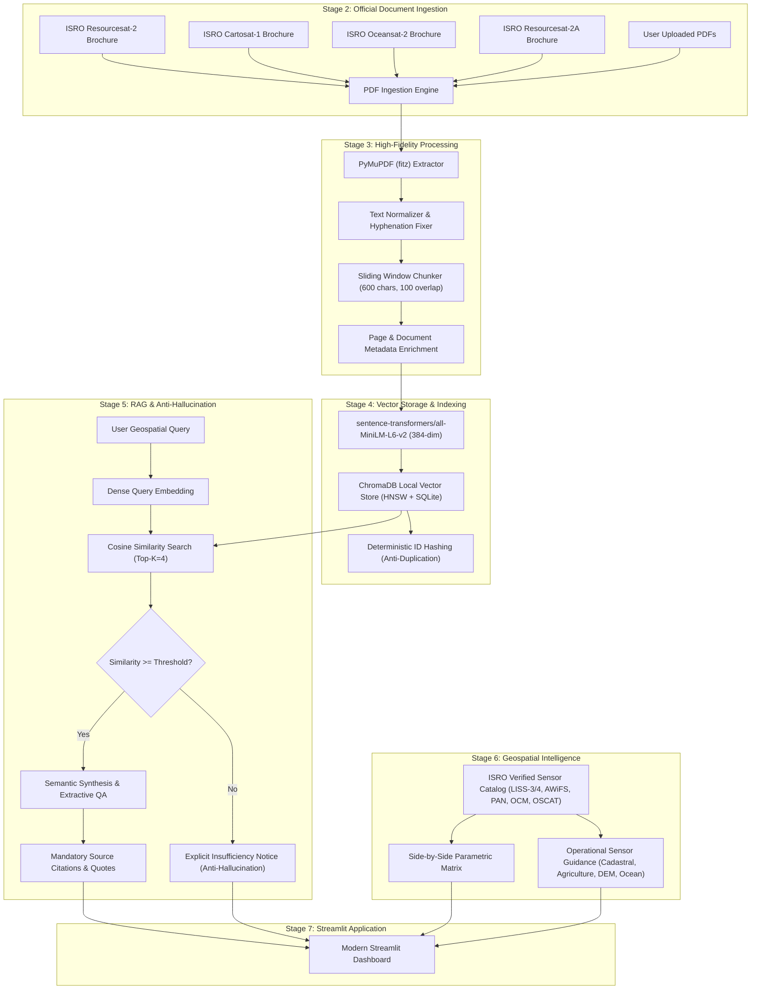

# BhuvanGeo-RAG: Architecture & Technical Design

## 1. System Overview

**BhuvanGeo-RAG** is an enterprise-grade Multimodal Geospatial Document and Mission Intelligence Assistant engineered for the **National Remote Sensing Centre (NRSC) / Indian Space Research Organisation (ISRO)**.

The system ingests official technical publications, user handbooks, and mission brochures for major Indian Earth Observation (EO) satellites—specifically **Resourcesat-1/2/2A**, **Cartosat-1/2/3**, **Oceansat-2/EOS-06**, and the **Bhuvan Geoportal**. It delivers grounded, zero-hallucination semantic question-answering, side-by-side payload comparisons, and operational sensor recommendations.

---

## 2. Component Breakdown

### 2.1 PDF Processing Engine (`src/pdf_processor.py`)
- **Library:** PyMuPDF (`fitz`), chosen for C-native speed, precise layout text boundary tracking, and minimal memory overhead.
- **Hyphenation Resolution:** Resolves line-break splits (e.g. `multi-\nspectral` -> `multispectral`).
- **Sliding Window Chunking:** Paragraph and sentence boundary aware windowing (default: 600 characters with 100 character overlap).
- **Graceful Scanned Page Handling:** Detects graphical or scanned pages (< 25 characters) and flags them rather than creating blank chunks.

### 2.2 Local Vector Database (`src/vector_store.py`)
- **Embedding Model:** `sentence-transformers/all-MiniLM-L6-v2` (384-dimensional dense vectors). Runs purely on local CPU with sub-10ms inference time.
- **Storage:** Persistent ChromaDB backed by DuckDB/SQLite and HNSW (Hierarchical Navigable Small World) graph indexing.
- **Idempotency:** Ingestion checks existing chunk IDs to prevent duplicate embeddings on repeated ingestion runs.

### 2.3 Anti-Hallucination RAG Pipeline (`src/rag_engine.py`)
- **Zero Inventions:** Under no circumstances are satellite specifications, orbits, or bands fabricated.
- **Confidence Gate:** If retrieval similarity falls below 0.35, the engine explicitly returns:
  `"Insufficient evidence in the ingested official ISRO/NRSC documentation to verify this specification."`
- **Mandatory Source Attribution:** Every response includes:
  1. Official Document Name
  2. Page Number
  3. Literal Text Excerpt
  4. Cosine Similarity Confidence Score

### 2.4 Geospatial Intelligence Catalog (`src/geospatial.py`)
- Verified parameter profiles for:
  - **LISS-IV:** 5.8 m resolution, 70 km swath (Resourcesat-2/2A), 10-bit radiometry.
  - **LISS-III:** 23.5 m resolution, 141 km swath, Green/Red/NIR/SWIR bands.
  - **AWiFS:** 56 m resolution, 740 km twin-head swath, 5-day revisit, 12-bit radiometry.
  - **Cartosat-1 PAN:** 2.5 m resolution, Fore (+26°) & Aft (-5°) stereo configuration for CartoDEM.
  - **Cartosat-2 PAN/MX:** 0.8 m sub-meter resolution, agile steerability.
  - **OCM-2/3:** 360 m resolution, 1420 km swath, 8/13 ocean color bands.
  - **Scatterometer (OSCAT):** Ku-band (13.515 GHz), 25 km wind vector cells.
- **Operational Guidance Engine:** Recommends sensors based on specific workflow criteria (e.g., parcel-level cadastral mapping vs. national crop monitoring) while strictly tagging recommendations apart from verified physical facts.

### 2.5 Streamlit Web Application (`app/app.py`)
- **Tab 1: Mission Intelligence Chat:** Interactive RAG assistant with real-time latency reporting and expandable citation cards.
- **Tab 2: Sensor Comparison & Specs:** Dynamic side-by-side comparison matrix with custom multi-sensor filtering and recommendation selector.
- **Tab 3: Ingested Document Library:** Searchable manifest of official publications with file sizes and source links.
- **Tab 4: Architecture & Diagnostics:** Real-time collection telemetry, tech stack breakdown, and guardrail verification.

